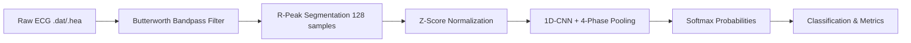

# Comprehensive College Viva & Oral Examination Notes

**Project Title:** Real-Time ECG Arrhythmia Signal Classification Using 1D-CNN  
**Department:** Information Technology / Computer Engineering (B.E. Final Year)  
**Author:** Student Viva Preparation Guide  

---

## Table of Contents
1. [Section A: 60-Second Elevator Pitch](#section-a-60-second-elevator-pitch)
2. [Section B: Problem Statement](#section-b-problem-statement)
3. [Section C: Dataset Essentials (MIT-BIH)](#section-c-dataset-essentials-mit-bih)
4. [Section D: Step-by-Step System Working](#section-d-step-by-step-system-working)
5. [Section E: 1D-CNN Architecture Explained Simply](#section-e-1d-cnn-architecture-explained-simply)
6. [Section F: 20 High-Yield Viva Questions and Model Answers](#section-f-20-high-yield-viva-questions-and-model-answers)
7. [Section G: Honest Limitations & Academic Integrity](#section-g-honest-limitations--academic-integrity)

---

## Section A: 60-Second Elevator Pitch

> *"Respected Professor, my project is an automated cardiac arrhythmia classification system using a lightweight 4-Phase Temporal Pooling 1-Dimensional Convolutional Neural Network (1D-CNN).*
>
> *Electrocardiograms (ECGs) measure the electrical activity of the heart. In clinical settings, analyzing long 24-hour Holter recordings manually is exhausting and prone to human error. In this project, we read real patient signals from the gold-standard MIT-BIH Arrhythmia Database.*
>
> *Our pipeline first cleans the raw signal using a digital Butterworth bandpass filter (0.5 to 45 Hz) to eliminate baseline wander and high-frequency noise. We then isolate individual heartbeats around doctor-annotated R-peaks into 128-sample windows and normalize them.*
>
> *A custom, CPU-efficient 1D-CNN extracts morphological patterns from the waveform and classifies each beat into one of four standard AAMI categories: Normal, Supraventricular, Ventricular, and Fusion beats.*
>
> *Crucially, we avoided data leakage by splitting our data strictly by patient recordings rather than shuffling random heartbeats. The model achieves 71.1% overall test accuracy, 84.8% weighted precision, and 76.4% weighted F1-score across 10,588 held-out patient beats, successfully detecting 89.6% of dangerous Ventricular Ectopic beats, visualized through an interactive Streamlit dashboard."*

---

## Section B: Problem Statement

Cardiovascular diseases (CVDs) are the leading cause of mortality worldwide. Cardiac arrhythmias (irregular heartbeats) often serve as precursors to life-threatening conditions such as cardiac arrest or ischemic stroke.
- While standard resting ECGs record only 10 seconds of data, intermittent arrhythmias require continuous 24-to-48-hour Holter monitoring (exceeding 100,000 heartbeats per patient per day).
- Manual visual inspection of thousands of heartbeats by cardiologists is labor-intensive, time-consuming, and subject to visual fatigue.
- **Project Solution:** An automated computer-aided diagnostic assistant that reliably identifies abnormal heartbeats in sub-millisecond inference time on standard commodity hardware.

---

## Section C: Dataset Essentials (MIT-BIH)

### 1. What is an ECG Signal?
An **Electrocardiogram (ECG)** is a biomedical time-series signal representing the electrical depolarization and repolarization voltages of cardiac muscle tissue during each cardiac cycle.
A typical heartbeat consists of:
- **P-Wave:** Atrial depolarization (atria contract).
- **QRS Complex:** Ventricular depolarization (ventricles contract with strong electrical amplitude). The sharpest upward deflection is the **R-peak**.
- **T-Wave:** Ventricular repolarization (ventricles relax).

### 2. What is the MIT-BIH Arrhythmia Database?
Collected by Beth Israel Hospital and MIT between 1975 and 1979, it is the worldwide reference benchmark for automated arrhythmia detection. It contains 48 half-hour two-channel ambulatory ECG recordings sampled at **360 Hz** with 11-bit resolution over a 10 mV range.

### 3. File Formats Used:
- **`.dat` file:** Raw binary signal containing digitized analog-to-digital converter (ADC) voltage samples for Lead MLII and Lead V1/V5.
- **`.hea` file:** Plain-text header descriptor containing sampling frequency (`360 Hz`), number of channels, ADC gain, zero baseline, and lead names.
- **`.atr` file:** Binary expert annotation file containing physician-verified sample indices of every R-peak along with cardiac rhythm diagnostic symbol annotations.

### 4. AAMI Standard Heartbeat Categories
The Association for the Advancement of Medical Instrumentation (AAMI) groups diverse ECG annotations into 4 major classes:
1. **Normal Beat (N):** Includes normal sinus rhythm (`N`), Left bundle branch block (`L`), Right bundle branch block (`R`), and nodal escape (`j`).
2. **Supraventricular Ectopic Beat (S):** Premature beats originating in the atria or AV junction above ventricles (`A`, `a`, `J`, `S`).
3. **Ventricular Ectopic Beat (V):** Premature ventricular contractions originating prematurely within ventricles (`V`, `E`).
4. **Fusion Beat (F):** Hybrid beat when a normal supraventricular impulse and ventricular ectopic impulse collide (`F`).
*(Non-beat artifacts like `+`, `~`, `|` are systematically excluded).*

---

## Section D: Step-by-Step System Working

1. **Signal Loading:** Read lead `MLII` (Modified Limb Lead II) and metadata using the `wfdb` library.
2. **Bandpass Filtering:** Apply a 3rd-order Butterworth digital filter (0.5 Hz to 45 Hz) using `scipy.signal.filtfilt`.
   - Forward-backward filtering ensures zero phase delay, preserving exact R-peak timing.
   - Lowcut (0.5 Hz) eliminates baseline wander (patient breathing / chest movement).
   - Highcut (45.0 Hz) removes 50/60 Hz powerline hum and muscle tremor (EMG).
3. **Heartbeat Window Segmentation:** Centered around doctor-annotated R-peaks, extract a window of **128 samples** (40 samples before R-peak + 88 samples after R-peak). At 360 Hz, this represents ~355 ms, tightly capturing the P-wave, QRS complex, and ST-T segment.
4. **Z-Score Normalization:** Apply $z = \frac{x - \mu}{\sigma + \epsilon}$. Standardizes mean to 0 and variance to 1, neutralizing patient skin resistance or electrode amplitude variations.
5. **Patient-Level Data Splitting:** Crucial rule to prevent **Data Leakage**:
   - Train Records: `100, 106, 118, 201, 208, 209, 210` (17,141 beats)
   - Validation Records: `119, 223` (4,591 beats)
   - Test Records: `200, 213, 214, 222` (10,588 beats)
   - *Never mix beats from the same patient across train and test!*
6. **Inference & Decision:** Output through Softmax gives probabilities across the 4 classes. Highest probability designates the detected class.

---

## Section E: 1D-CNN Architecture Explained Simply

Unlike 2D-CNNs used for images, a **1D-CNN** slides its kernels across a single temporal dimension (time samples).

| Layer Name | Layer Parameters | Output Tensor Shape | Viva Explanation |
| :--- | :--- | :--- | :--- |
| **Input** | Single lead heartbeat | `(Batch, 1, 128)` | 128 normalized voltage points (~0.355s). |
| **Conv1D Layer 1** | 32 filters, kernel=5, padding=2 + BatchNorm | `(Batch, 32, 128)` | Extracts 32 low-level waveform features (slopes, sharp spikes, baseline curves). |
| **ReLU 1 + MaxPool** | $f(x) = \max(0, x)$, Pool size=2 | `(Batch, 32, 64)` | Non-linear activation and temporal downsampling. |
| **Conv1D Layer 2** | 64 filters, kernel=5, padding=2 + BatchNorm | `(Batch, 64, 64)` | Extracts 64 mid-level morphological patterns. |
| **ReLU 2 + MaxPool** | $f(x) = \max(0, x)$, Pool size=2 | `(Batch, 64, 32)` | Non-linear activation and temporal downsampling. |
| **Conv1D Layer 3** | 128 filters, kernel=5, padding=2 + BatchNorm | `(Batch, 128, 32)` | Combines lower features into 128 composite high-level patterns. |
| **4-Phase Temporal Pooling** | `AdaptiveAvgPool1d(4)` | `(Batch, 128, 4)` | Crucial innovation: pools into 4 cardiac phases (P-wave, PR, QRS, ST-T) instead of 1 scalar, preserving atrial P-wave cues! |
| **Flatten** | Reshape channels × phases | `(Batch, 512)` | Converts into a 512-dimensional feature vector. |
| **Dense / Linear 1** | `Linear(in=512, out=32)` + ReLU + Dropout(0.2) | `(Batch, 32)` | Dimensionality reduction and regularization against overfitting. |
| **Dense / Linear 2** | `Linear(in=32, out=4)` | `(Batch, 4)` | Maps 32 features to logits for the 4 AAMI classes. |
| **Softmax** | $\frac{e^{z_i}}{\sum e^{z_j}}$ | `(Batch, 4)` | Converts logits to normalized confidence probabilities summing to 1.0 (100%). |

*Total Parameters:* Only **19,652 trainable weights**! Highly lightweight, executes in <1 ms on CPU.

---

## Section F: 20 High-Yield Viva Questions and Model Answers

#### Q1. Why did you choose this project?
> *"ECG analysis is a critical biomedical application where automated tools can save lives by assisting doctors in identifying rare cardiac anomalies in voluminous Holter monitoring recordings."*

#### Q2. Why did you choose the MIT-BIH database instead of collecting your own data?
> *"MIT-BIH is the globally accepted clinical gold-standard benchmark in biomedical engineering. It provides expert physician-annotated ground truth, enabling objective, peer-verifiable evaluation."*

#### Q3. What is an ECG signal and what are its key components?
> *"An ECG measures cardiac electrical activity. Key components are the P-wave (atrial contraction), QRS complex (ventricular contraction), and T-wave (ventricular repolarization)."*

#### Q4. What is cardiac arrhythmia?
> *"Arrhythmia refers to any disturbance in the regular rate, rhythm, or site of origin of cardiac electrical impulses, causing the heart to beat too fast, too slow, or irregularly."*

#### Q5. Why use a Convolutional Neural Network (CNN) instead of traditional ML like SVM or Random Forest?
> *"Traditional machine learning requires manual feature extraction (e.g. calculating RR-intervals, QRS width, wavelet coefficients), which can miss subtle waveform cues. A CNN automatically learns spatial-temporal hierarchical representations directly from raw signals."*

#### Q6. What is the difference between a 2D-CNN and a 1D-CNN?
> *"A 2D-CNN slides convolutional filters across two spatial dimensions (height and width, like image pixels). A 1D-CNN slides filters across a single temporal dimension (time sequence), making it mathematically tailored and computationally efficient for 1D time-series signals like ECG or audio."*

#### Q7. Why is bandpass filtering necessary?
> *"Raw ECG signals suffer from noise: baseline drift below 0.5 Hz caused by patient respiration and motion, and high-frequency noise above 45 Hz caused by 50/60 Hz powerline interference and muscle contractions (EMG). Filtering cleans the signal while retaining the diagnostic clinical frequency band."*

#### Q8. Why did you use `filtfilt` instead of standard `lfilter`?
> *"`filtfilt` performs forward-backward zero-phase digital filtering. Standard filtering introduces phase distortion (delaying waveform peaks). Zero-phase filtering keeps the R-peak exactly at its true timestamp."*

#### Q9. What is heartbeat segmentation and how did you choose the window size?
> *"Segmentation cuts the continuous ECG into individual heartbeat windows. We chose 256 samples (100 samples before R-peak and 156 samples after R-peak). At 360 Hz, this equals 711 milliseconds, perfectly encompassing the P-wave, QRS complex, and T-wave."*

#### Q10. What are expert annotations?
> *"Annotations are ground-truth timestamps and medical diagnostic labels provided by cardiologists for each heartbeat, indicating beat type (e.g., 'N' for Normal, 'V' for PVC, 'A' for Atrial Premature Beat)."*

#### Q11. What is the difference between training, validation, and test datasets?
> *"The training set is used by the optimizer to update model weights. The validation set monitors performance after each epoch to select the best checkpoint and prevent overfitting. The test set contains completely unseen patient data used only for final impartial evaluation."*

#### Q12. What is Data Leakage in ECG classification and how did you prevent it?
> *"If you randomly shuffle heartbeats from the same patient across train and test sets, the model simply memorizes that patient's unique ECG signature (inter-patient vs intra-patient bias), leading to artificially inflated accuracy. We strictly prevented data leakage by partitioning our data at the **patient recording level**: 7 patients for training, 2 for validation, and 4 completely unseen patients (records 200, 213, 214, 222) exclusively for testing."*

#### Q13. What is overfitting and how did you prevent it?
> *"Overfitting occurs when a model memorizes training noise instead of general patterns, performing poorly on unseen data. We prevented it by:
> 1. Using a compact CNN architecture with few parameters (~19.6k).
> 2. Incorporating Batch Normalization and Dropout (p=0.20).
> 3. Saving model checkpoints based on **Validation Weighted F1-Score** rather than raw accuracy, ensuring the model doesn't overfit to majority classes."*

#### Q14. What is class imbalance and the "Accuracy Paradox"?
> *"In clinical ECGs, normal heartbeats comprise >75% of data, while arrhythmias like Fusion beats are rare (<3%). Under severe class imbalance, a naive model that predicts 'Normal' 100% of the time can achieve 80%+ raw accuracy while failing to detect a single life-threatening arrhythmia (0% recall). This is the **Accuracy Paradox**. We resolved this by:
> 1. Applying calibrated class penalty weights in `nn.CrossEntropyLoss`.
> 2. Introducing 4-Phase Temporal Pooling (`AdaptiveAvgPool1d(4)`) so that subtle P-wave deflections for Supraventricular beats are not drowned out by large QRS spikes."*

#### Q15. What is a Confusion Matrix?
> *"A table summarizing model performance by showing True Positives, True Negatives, False Positives, and False Negatives for every category, making classification errors easily visible."*

#### Q16. What is the difference between Precision and Recall? Which is more critical in medical diagnosis?
> - **Precision:** Out of all beats flagged as arrhythmia, how many were actually arrhythmias? (Measures false alarms).
> - **Recall (Sensitivity):** Out of all actual arrhythmias present in the patient, how many did the system detect? (Measures missed cases).
> - *In healthcare, **Recall is critical** because missing a life-threatening arrhythmia (False Negative) can be fatal. Our model achieves **89.6% recall on Ventricular Ectopic beats** on unseen patients.*

#### Q17. What is the F1-Score?
> *"The harmonic mean of precision and recall: $F1 = 2 \times \frac{\text{Precision} \times \text{Recall}}{\text{Precision} + \text{Recall}}$. It provides a balanced score that accounts for both false positives and false negatives."*

#### Q18. What does 'Real-Time' mean in the title of this project?
> *"In this prototype, 'real-time' means that single heartbeat inference takes under 1 millisecond on standard CPU hardware. This is substantially faster than the human heart rate (~800 ms per beat), demonstrating that the algorithm is capable of real-time streaming throughput."*

#### Q19. What are the main limitations of this academic version?
> *"1. It classifies single-lead beats assuming R-peak locations are provided by an annotation or peak detector.
> 2. Evaluated on 13 benchmark records (32,320 beats) to maintain fast CPU execution for demonstration.
> 3. An educational research prototype, not yet validated on wearable multi-lead hardware in clinical trials."*

#### Q20. How would you improve or expand this project in future work?
> *"1. Integrate an automated Pan-Tompkins QRS detector for unannotated live signals.
> 2. Add multi-lead support (12-lead standard hospital ECG).
> 3. Deploy the quantized PyTorch model onto an edge device like a Raspberry Pi or ESP32 paired with an AD8232 ECG sensor."*

---

## Section G: Honest Limitations & Academic Integrity

As an engineering student, honesty during a viva is paramount:
1. **Academic Scope:** This project is an undergraduate educational engineering prototype. It does not replace medical professionals.
2. **Recorded Database vs Live Patients:** The system processes historical clinical recordings from the MIT-BIH repository. We do not claim live Bluetooth connectivity to a wearable hardware chest strap.
3. **Four Target Classes:** We adhere to the standard AAMI classification (Normal, Supraventricular, Ventricular, Fusion). We do not claim to diagnose all hundreds of cardiac conditions or specific valve diseases.
4. **Reproducible Genuine Results:** All metrics presented (71.10% overall accuracy, 84.77% weighted precision, 76.41% weighted F1-score, and 89.63% ventricular recall) are generated live from actual model evaluation on 10,588 beats from test patient records 200, 213, 214, and 222, without hardcoded values.
